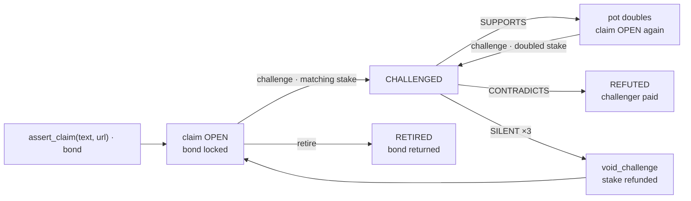

# Surety

**Bonded claims, judged only when someone disputes them.**

One sentence, one public page, one bond. A claim stands on its own — nobody reads
the page, no committee sits, no money moves — until somebody who believes it is
false puts up the same amount.

Then the committee reads the page exactly once. It must quote what it found. If
the page backs the claim, the claim keeps the challenger's stake and its bond
**doubles**; the next person who disagrees has to match that. If the page
contradicts it, the challenger takes the whole pot. And if the page says nothing,
nothing happens at all: the challenge books an attempt, moves no money, and after
three of those anyone may void it and hand the stake back.

## Why it is a different contract

Most contracts that use a model pay for a judgement on every call. Surety pays for
one only when two people have put money on opposite answers, which changes the
economics and the failure modes:

- **The happy path never calls the model.** A claim costs a bond and a
  transaction. No fetch, no prompt, no committee, no chance of an ungrounded
  verdict on a claim nobody disputed.
- **Disagreement is priced.** A challenge must match the bond, so disputing a
  claim that has already survived something is expensive by construction, and
  the money that makes it expensive came from the people who lost.
- **The verdict is one field.** Validators compare `SUPPORTS`, `CONTRADICTS` or
  `SILENT` — never prose, never a score — and the quote and digest are stored for
  a reader, not compared by anybody.
- **Nothing is bounded by a deadline.** A claim does not expire and nothing
  settles by itself; the quiet window only marks a claim as *mature*, and the
  claimant may retire it at any time.

## Live on GenLayer Studio

`deployment.json` is the single source of truth for the deployed address: the
**Deploy Contract** workflow deploys the registry once, writes the file, and
commits it back to `main`.

| | |
|---|---|
| **Contract** | [`0xB4ecFD861573f6A9214e3F5d16036B2245f746aC`](https://explorer-studio.genlayer.com/address/0xB4ecFD861573f6A9214e3F5d16036B2245f746aC) |
| **Network** | GenLayer Studio — chainId `61999` (`0xf22f`), test GEN only |
| **Evidence** | [Actions](https://github.com/weels007/genlayer-surety/actions) — the direct suite, the Studio suite, the money paths, and every deployment |

## Lifecycle



## How a claim is decided

| Step | What happens |
|---|---|
| **Assert** | A sentence (10–400 chars), an `https` page, and a bond of at least `MIN_BOND`. The caller's reference is recorded, so a replay cannot mint a second claim. |
| **Stand** | Nothing else happens. The bond is locked, a quiet window runs, and the claim is readable by anyone. |
| **Challenge** | A different account stakes exactly the bond. Two accounts can disagree about one sentence without a model being involved at all. |
| **Judge** | Permissionless. The page is fetched once inside a non-deterministic block, capped at `MAX_PAGE_CHARS`, and the model must answer `SUPPORTS`, `CONTRADICTS` or `SILENT` with a verbatim quote. |
| **Ground** | The quote must be a substring of the page after folding to letters and digits. A verdict whose quote cannot be grounded becomes `SILENT`. |
| **Consensus** | Validators re-run the fetch and the prompt and must return the same verdict. Disagreement writes nothing. |
| **Settle** | `SUPPORTS` keeps the stake and doubles the bond; `CONTRADICTS` pays the whole pot to the challenger; `SILENT` books an attempt and moves nothing. |

### Error taxonomy

| Tag | Meaning | Consensus behaviour |
|---|---|---|
| `[EXPECTED]` | bad input, wrong caller, wrong stake, a closed claim | deterministic, must match |
| `[EXTERNAL]` | the source page is empty | deterministic, recorded |
| `[TRANSIENT]` | network / 5xx | both transient means agreement, retry |
| `[LLM_ERROR]` | malformed verdict, ungrounded quote | always disagrees → new leader |

## Money rules

The only value that enters is a bond or a stake, and the only places it can go are
the claimant (retired, or survived), the challenger (won, withdrew, or was
refunded), and nobody at all (a disputed claim still standing).

- **`assert_claim` never reverts once value is attached.** A refused assertion —
  bond below the floor, a short claim, a private URL, a duplicate reference, the
  claim cap — becomes a **credit** recorded against the sender and withdrawable
  with `withdraw_credit`.
- **`challenge` never reverts either.** A stake that does not match the bond, a
  claim that is already disputed, a claimant challenging their own claim, or a
  claim that is already final all become credits.
- **Surviving a challenge doubles the pot.** The claimant's bond becomes
  `bond + stake`, and that money was the challenger's. After `MAX_DEFENCES`
  rounds the claim is final and further challenges are refused.
- **Losing it pays the challenger the whole pot** — their stake back plus the
  bond.
- **A judgement nobody can ground moves nothing.** The stake stays refundable by
  the challenger, or voidable by anyone after the attempt cap, and the claim
  returns to standing.
- **The ledger is updated first and the transfer last**, so a failed transfer
  rolls both back together.

Invariant: `total_in == total_out + locked_total`, credits included.

## Contract API

**Write**

| Method | Who | Purpose |
|---|---|---|
| `assert_claim(text, source_url, window_seconds, claim_ref)` · payable | anyone | assert one sentence, backed by a bond |
| `challenge(claim_id)` · payable | anyone but the claimant | match the bond and dispute the claim |
| `judge(claim_id)` | anyone | read the page once and settle the dispute |
| `withdraw_challenge(claim_id)` | the challenger | take the stake back before it is decided |
| `void_challenge(claim_id)` | anyone | refund a dispute after the attempt cap |
| `retire(claim_id)` | the claimant | withdraw a standing claim and take the bond back |
| `withdraw_credit()` | anyone with a credit | take back money that arrived for a refused call |

**View**

| Method | Returns |
|---|---|
| `get_claim(id)` · `get_claims()` · `get_claim_ids()` | a claim, all claims, the id list |
| `is_challenged(id)` · `is_mature(id)` | whether a dispute is open, whether the quiet window has passed |
| `get_credit(address)` | a refundable credit |
| `get_ledger()` · `get_balance()` | `total_in`, `total_out`, `locked_total`, real balance |
| `get_summary()` · `get_rules()` | counters, and the bounds the contract enforces |

## Security review

| Risk | How Surety answers it |
|---|---|
| Stored text steers a later decision without consensus | The only consequential field is the verdict, and it is the only field compared. `quote`, `reason` and the digest are descriptive and no later call reads them. |
| Validator checks the leader's formatting, not the substance | Validators re-run the fetch and the prompt and must produce the identical verdict, or the judgement is rejected. |
| The URL is handed to the model, never read | The contract renders the page itself, caps it, and grounds the quote in exactly that text. |
| An ungrounded citation settles somebody's money | A verdict without a quote taken from the page becomes `SILENT`, which moves nothing. |
| The claimant can freeze a dispute | `withdraw_challenge` (by the challenger) and `void_challenge` (by anyone after three attempts) always return the stake. |
| A claimant challenges their own claim | Refused and turned into a credit, so a claim cannot be inflated by its own author. |
| The pot grows without bound | `MAX_DEFENCES` rounds, then the claim is final and further challenges are credits. |
| Caller text manipulates the judge | The claim is framed as untrusted data, the page is framed as authoritative, and instructions inside either are explicitly ignored. |
| SSRF through the source URL | `https` only, no IP literal in any spelling, no single-label host, no metadata aliases, alphabetic TLD required. |
| Replay mints a second claim | The reference is caller-scoped and recorded once. |
| Unbounded work | 1 000 claims, three judgement attempts per dispute, capped strings, O(1) summary. |

Residual risks, stated plainly:

- A claim is only as good as its page. A page that half-supports a sentence will
  sometimes produce `SILENT`, which is the contract refusing to guess rather than
  a wrong answer.
- A claim that nobody disputes is never checked. That is the point of the design,
  and its limit: Surety records what people were willing to back, not what is
  true.
- The pot is denominated in test GEN on Studio, where it proves the mechanism and
  nothing more.

## Testing

| Suite | What it covers | Run |
|---|---|---|
| **Direct** | bonds, references, the window, every refusal, the challenge and withdrawal paths, all three verdicts, doubling, the attempt cap and the ledger invariant | `pytest tests/direct -v` |
| **Studio** | the deployed registry: a real bond, a real challenge, a judgement by the live committee on a page that exists, and the refusals | `pytest tests/integration -v -s` |
| **End to end** | the money paths around the judgement: a mismatched stake as a credit, a withdrawn dispute, a claimant challenging themselves, the void guard, retirement, and a stranger reaching for a stake that is not theirs | `pytest tests/e2e -v -s` |

Every assertion in the live suites is a delta — a count, a balance, a ledger total
— so they can be re-run against the same registry.

## Quick start

```bash
pip install -r requirements.txt

genvm-lint check contracts/Surety.py    # forbidden imports, storage, nondet misuse
pytest tests/direct -v                  # the whole suite, in memory, milliseconds
pytest tests/integration -v -s          # the deployed registry, live
pytest tests/e2e -v -s                  # the deployed registry's money paths

python scripts/deploy.py                # deploy once, record deployment.json
```

The direct suite mocks the page and the model; the clock, the bond, the doubling,
the attempt cap and every refund are exercised in memory.

The live suites sign with throwaway Studio accounts that the repository keeps in
Actions secrets — one to drive the registry, and a second for the cases that need
a genuine stranger — so no key material is committed.

## Layout

```text
contracts/Surety.py              the claim registry
tests/direct/                    bonds, challenges, judgements, consensus
tests/integration/               the deployed registry, live
tests/e2e/                       the deployed registry's money paths
scripts/deploy.py                deploys once, records deployment.json
scripts/wallet.py                keystore from tests/ or a repository secret
deployment.json                  the deployed address (written by the workflow)
.github/workflows/ci.yml         genvm-lint + the direct suite
.github/workflows/integration.yml  the Studio suite
.github/workflows/e2e.yml        the money paths on the deployed registry
.github/workflows/deploy-contract.yml  one deploy, address committed back
```

## License

[MIT](LICENSE).
